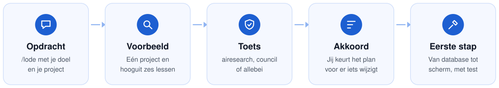
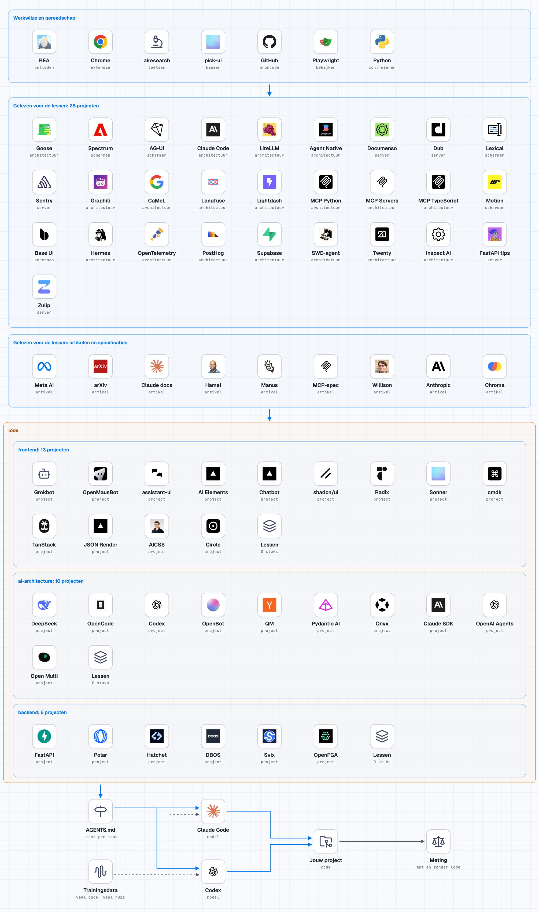

<p align="center"></p>

<p align="center">


</p>

<p align="center"><b>De broncode van Codex, OpenBot, Onyx, Polar en 25 andere projecten, als voorbeeld voor Claude Code, Codex en Cursor.</b></p>

<p align="center"><a href="#installeren">Installeren</a> · <a href="#wat-je-typt">Wat je typt</a> · <a href="#zo-zit-het-in-elkaar">Diagram</a> · <a href="#de-projecten">De projecten</a> · <a href="#de-lessen">De lessen</a> · <a href="#wat-je-moet-weten">Wat je moet weten</a></p>

## Waarom dit bestaat

Vraag Claude of Codex om een scherm en je krijgt meestal het scherm dat het vaakst in het trainingsmateriaal zat: drie kaarten op een rij met dezelfde iconen. Aan een lege lijst of een laadfout is niet gedacht. Aan de serverkant zie je het minder snel, maar daar gebeurt hetzelfde. Voorbeelden op internet laten zelden zien wie wat mag, of wat er gebeurt als een proces halverwege omvalt en iemand nog een keer klikt, en het model bedenkt dat dan ook niet vanzelf.

Mijn eerste versie van lode bestond uit losse stukjes code. Je kon er een idee uit halen, maar geen heel chatvenster of goedkeuringsknop mee overnemen. Nu staat van elk project de broncode erin. Codex van OpenAI, de chat-app van Vercel, het betaalplatform Polar en de zoekmachine Onyx bijvoorbeeld. Zeg je dat je een chatvenster wilt, dan kijkt je model eerst hoe Vercel het gemaakt heeft en bouwt het daarna na in jouw project.



## Wat erin zit

| Wat | Waar het je mee helpt |
|---|---|
| **De broncode van 29 projecten** | Je model leest hoe het daar gemaakt is, en neemt een scherm of onderdeel over |
| **Een gids per map** (`CODEBASES.md`) | Vertelt in welk bestand het chatvenster, de rechtencontrole of de wachtrij zit, want Codex alleen al heeft meer dan 8.000 bestanden |
| **111 lessen** | Korte uitleg van één probleem en hoe een van die projecten het oplost, zie [De lessen](#de-lessen) |
| **6 werkwijzen** | Opdrachten zoals `/lode` waarmee je model stap voor stap werkt (Claude Code noemt ze skills) |

## Installeren

```bash
git clone --depth 1 https://github.com/robinbril/lode.git
```

```bash
python3 lode/install.py
```

Het script koppelt de werkwijzen aan Claude Code, Codex en Cursor. Wat je al hebt blijft staan, en van de projecten wordt niets geïnstalleerd of gestart.

## Wat je typt

| Je wilt | Je typt | Wat er gebeurt |
|---|---|---|
| Iets toevoegen aan een bestaand product | `/lode Voeg een goedkeuringsknop toe aan [project], voordat de agent een mail verstuurt` | Je model kijkt eerst of je al zoiets hebt, leest daarna hoe OpenBot het doet en schrijft een plan |
| Een nieuw project | `/lode Nieuw project: [naam] voor [gebruiker] met [taak]` | Je krijgt twee opzetten om uit te kiezen en een eerste week met elke dag iets dat werkt |
| Een scherm overnemen | `/lode Neem het invoerveld van grokbot over in [project], in Vue 3 en onze vormgeving` | Je krijgt eerst een lijst met alles wat het veld kan, ook met het toetsenbord en als er iets misgaat |
| Een keuze maken | `/lode We twijfelen tussen Hatchet en DBOS voor achtergrondwerk` | Je krijgt per optie het beste voorbeeld, een advies, en wanneer je beter het andere kiest |

Elk plan gaat eerst langs `airesearch` of `council`, omdat een model uit zichzelf vaak maar met één idee komt. Alleen bij een wijziging in één bestand die je zo terugdraait, mag die toets overgeslagen worden. Er verandert niets tot jij akkoord geeft. Twijfel je zelf nog, dan krijg je een aanbeveling met hooguit twee alternatieven ernaast. In [`prompts.md`](skills/lode/references/prompts.md) staan opdrachten die je zo kan plakken.

## Zo zit het in elkaar

<p align="center">
<picture>
<source media="(prefers-color-scheme: dark)" srcset="docs/lode-dark.png">

</picture>
</p>

## De projecten

### AI en agents - goedkeuring, afscherming, bedrijfskennis

| Project | Wat het is | Wat je eruit haalt |
|---|---|---|
| [`codex`](ai-architecture/codex-commandos-en-afscherming) - commando's en afscherming | De programmeeragent van OpenAI voor de terminal, in Rust | Welk commando een agent mag uitvoeren en hoe je hem afschermt van de rest van je computer |
| [`opencode`](ai-architecture/opencode-agent-in-typescript) - agent in TypeScript | Open programmeeragent in TypeScript | Hoe een agent werkt met verschillende modellen en zijn gesprekken bewaart |
| [`deepseek-harness`](ai-architecture/deepseek-harness-uitbreidbare-agent) - uitbreidbare agent | De agent van DeepSeek, waarin elk onderdeel los te vervangen is | Een agent bouwen die je kan uitbreiden, met een logboek van alles wat hij doet |
| [`claude-agent-sdk`](ai-architecture/claude-agent-sdk-claude-code-in-je-product) - Claude Code in je product | Het pakket van Anthropic om Claude Code vanuit Python te gebruiken | Claude Code in je eigen product zetten en ingrijpen voordat hij iets doet |
| [`openai-agents`](ai-architecture/openai-agents-werk-doorgeven) - werk doorgeven | Het pakket van OpenAI om agents te maken in Python | Een agent die werk doorgeeft aan een andere, en wacht op goedkeuring |
| [`pydantic-ai`](ai-architecture/pydantic-ai-agent-in-python) - agent in Python | Agents in Python van de makers van Pydantic | Een agent die na een herstart verdergaat waar hij was, en hoe je test of hij goed antwoordt |
| [`open-multi-agent`](ai-architecture/open-multi-agent-taken-verdelen) - taken verdelen | Laat meerdere agents samenwerken, in TypeScript | Taken verdelen over agents en achteraf zien wie wat deed |
| [`openbot`](ai-architecture/openbot-goedkeuring-en-logboek) - goedkeuring en logboek | Desktop-app met AI-collega's die elk een eigen computer hebben | De goedkeuringsknop, de regels daarachter en het logboek |
| [`qm`](ai-architecture/qm-teamagent-in-slack) - teamagent in Slack | Eén agent voor een heel team, in Slack en op het web | Een agent die per persoon en per kanaal onthoudt wat hij mag en weet |
| [`onyx`](ai-architecture/onyx-bedrijfskennis-met-rechten) - bedrijfskennis met rechten | Zoekmachine over je bedrijfskennis, gekoppeld aan meer dan 50 apps | Zoeken in documenten waarbij iedereen alleen vindt wat hij mag zien |

### Schermen - chat, menu's, meldingen, takenbord

| Project | Wat het is | Wat je eruit haalt |
|---|---|---|
| [`chatbot`](frontend/chatbot-compleet-chatprogramma) - complete chat-app | De voorbeeldchat van Vercel, in Next.js | Een complete chat-app om mee te beginnen |
| [`grokbot`](frontend/grokbot-invoerveld-en-werkplek) - invoerveld en werkplek | Mijn eigen nabouw van Grok Bot, in gewoon JavaScript | Het invoerveld, de gesprekkenlijst en het computerpaneel |
| [`openmausbot`](frontend/openmausbot-bots-en-meekijken) - bots en meekijken | Chat-app met een team van bots die op je eigen computer draaien | De goedkeuringskaart, en meekijken terwijl een bot werkt |
| [`assistant-ui`](frontend/assistant-ui-chatonderdelen) - chatonderdelen | Onderdelen voor een chat zoals ChatGPT, in React | Meescrollen met het antwoord, berichten bewerken, bijlagen |
| [`ai-elements`](frontend/ai-elements-antwoorden-tonen) - antwoorden tonen | Onderdelen van Vercel om antwoorden van een model te tonen, gaat op in shadcn/ui | Codeblokken, bronnen en denkstappen in een antwoord |
| [`aicss`](frontend/aicss-agentgesprekken) - agentgesprekken | Kant-en-klare onderdelen voor gesprekken met een agent, in React | Laten zien dat een agent nadenkt of ergens mee bezig is |
| [`json-render`](frontend/json-render-scherm-door-model) - scherm door model | Laat een model zelf een scherm samenstellen uit onderdelen die jij kiest | Een dashboard op verzoek, zonder dat het model onderdelen verzint |
| [`shadcn-ui`](frontend/shadcn-ui-knoppen-en-formulieren) - knoppen en formulieren | Knoppen, formulieren en tabellen die je in je project kopieert | Onderdelen die je zelf aanpast in plaats van installeert |
| [`radix-primitives`](frontend/radix-primitives-menus-en-dialogen) - menu's en dialogen | De ongestylede basis onder menu's, dialogen en hulpteksten | Menu's die ook met het toetsenbord en een schermlezer werken |
| [`cmdk`](frontend/cmdk-zoekvenster) - zoekvenster | Het zoekvenster dat je met ⌘K opent | Snel zoeken en opdrachten geven |
| [`sonner`](frontend/sonner-meldingen) - meldingen | De korte meldingen die in een hoek verschijnen | Meldingen die netjes stapelen en verdwijnen |
| [`tanstack-virtual`](frontend/tanstack-virtual-lange-lijsten) - lange lijsten | Toont lange lijsten door alleen de zichtbare rijen te tekenen | Een lijst met tienduizend rijen die niet hapert |
| [`circle`](frontend/circle-takenbord) - takenbord | Projectbeheer in de stijl van Linear | Een takenbord met filters, statussen en projecten |

### Server - inloggen, betalen, achtergrondwerk, rechten

| Project | Wat het is | Wat je eruit haalt |
|---|---|---|
| [`fastapi-template`](backend/fastapi-template-inloggen-en-database) - inloggen en database | De officiële startversie van een webdienst met FastAPI, Postgres en React | Inloggen, gebruikers en een database die meteen werken |
| [`polar`](backend/polar-betalen-en-abonnementen) - betalen en abonnementen | Betaalplatform voor softwarebedrijven | Abonnementen, verbruik afrekenen, proefperiodes en kortingen |
| [`hatchet`](backend/hatchet-achtergrondwerk) - achtergrondwerk | Voert zwaar werk uit op de achtergrond, in Go | Een wachtrij waarin één grote klant de rest niet ophoudt |
| [`dbos`](backend/dbos-hervatten-na-storing) - hervatten na storing | Pakket voor Python dat werk laat doorgaan na een storing, met alleen Postgres | Een bestelling of import die na uitval verdergaat waar hij was |
| [`svix`](backend/svix-webhooks-versturen) - webhooks versturen | Verstuurt webhooks: berichten waarmee jouw app een andere app waarschuwt | Ondertekenen, opnieuw proberen en bijhouden wat is aangekomen |
| [`openfga`](backend/openfga-wie-mag-wat) - wie mag wat | Houdt bij wie wat mag, naar het voorbeeld van Google Zanzibar | Rechten zoals in Google Drive, waar toegang tot een map ook voor de bestanden geldt |

## De lessen

Een les is één bladzijde over één probleem. [Les 56](ai-architecture/lessen-per-probleem/56-exactly-once-approval.md) gaat bijvoorbeeld over iemand die een betaling goedkeurt terwijl het verzoek door een haperende verbinding twee keer binnenkomt. OpenBot lost dat op door de goedkeuring in de database in één stap van "goedgekeurd" naar "gebruikt" te zetten, zodat de tweede poging niets meer vindt. In de les staan die oplossing met een stukje code, de plek in OpenBot waar je het terugvindt, wanneer je het niet nodig hebt, en een vraag waarmee je je eigen code controleert.

Nog een paar: [meescrollen met een chatantwoord tot iemand omhoog scrolt](frontend/lessen-per-probleem/01-scroll-anchoring-streaming-chat.md), [bedrijfskennis doorzoeken zonder dat iemand te veel ziet](ai-architecture/lessen-per-probleem/41-permission-aware-retrieval-fail-closed.md) en [sleutels versleuteld bewaren](backend/lessen-per-probleem/15-secrets-encryption.md). Er zijn er 70 over AI, 23 over schermen en 18 over de server. Je hoeft ze niet zelf op te zoeken, want `AGENTS.md` vertelt je model welke bij je taak horen.

Van de eerste 92 lessen moesten er 81 worden verbeterd, nadat een tweede model ze naast de code had gelegd. De regelnummers klopten toen wel. Of de verwijzingen kloppen, kan je zelf nakijken:

```bash
python3 check.py
```

## De werkwijzen

| Naam | Waarvoor |
|---|---|
| [`lode`](skills/lode/SKILL.md) | Iets toevoegen, nieuw bouwen of overnemen, met een plan dat jij goedkeurt |
| [`airesearch`](ai-architecture/skills/airesearch/SKILL.md) | Een AI-ontwerp beoordelen op tien punten, met de coderegel erbij |
| [`council`](ai-architecture/skills/council/SKILL.md) | Een lastige keuze voorleggen aan een paar adviseurs die elkaars antwoord beoordelen zonder te weten van wie het is |
| [`ui-ophalen`](frontend/skills/ui-ophalen/SKILL.md) | Een scherm ophalen dat hier nog niet in staat |
| [`rea`](frontend/skills/rea/SKILL.md) | Uitzoeken hoe een website, app of pakket in elkaar zit |
| [`pick-ui-library`](frontend/skills/pick-ui-library/SKILL.md) | Een verzameling schermonderdelen kiezen |

## Wat je moet weten

Of je resultaat er echt beter van wordt, heb ik nog niet gemeten. Eén keer heb ik twee plannen laten beoordelen zonder dat de beoordelaar wist welk plan van wie was, en het plan met `/lode` kreeg 59,5 punten tegen 64,5 voor dat zonder. Daarna heb ik de werkwijze ingekort en die nieuwe versie is niet opnieuw getest. Neem dus een taak die je goed kent en doe hem één keer met `/lode` en één keer zonder.

Verder:

- De projecten zijn om te lezen. Start of installeer ze niet vanuit deze map, want ze krijgen hier geen beveiligingsupdates.
- De code van Claude Code zelf is gesloten en staat er niet in, alleen het pakket om het aan te sturen.
- Grote bestanden, foto's en video's zijn weggelaten, en ook de onderdelen met een betaalde licentie. Bij `grokbot` ontbreken de lettertypes, iconen en animaties van Grok, dus die start niet zomaar.
- Een `AGENTS.md` van een ander heet hier `AGENTS.md.bron`, zodat jouw model niet per ongeluk diens regels volgt.

## Bijwerken

Van elk project staat in `codebases.json` welke versie erin zit. Zet daar een nieuwere neer en haal hem op:

```bash
python3 copy.py take sonner
```

Met `python3 copy.py check` zie je of de bestanden nog hetzelfde zijn als bij de maker.

## Herkomst en licenties

De code is van de makers en houdt hun licentie. Neem je iets over, neem dan ook de licentietekst mee. Wat ik wel gelezen heb maar niet gekopieerd, staat in [`sources.json`](sources.json).

<details>
<summary>Alle 29 projecten met bron, versie en licentie</summary>

| Project | Bron | Versie | Licentie |
|---|---|---|---|
| `deepseek-harness` | [deepseek-ai/deepseek-harness](https://github.com/deepseek-ai/deepseek-harness) | [`4b399c39a`](https://github.com/deepseek-ai/deepseek-harness/tree/4b399c39a6d1479cd84ca591b4d7c88e24d38a96) | MIT |
| `opencode` | [anomalyco/opencode](https://github.com/anomalyco/opencode) | [`0089ba9e3`](https://github.com/anomalyco/opencode/tree/0089ba9e39a9ff7701b83fa87d62964612b61a66) | MIT |
| `codex` | [openai/codex](https://github.com/openai/codex) | [`02390c8d8`](https://github.com/openai/codex/tree/02390c8d8e39a9b72d12e04e83987d5eb6801310) | Apache-2.0 |
| `openbot` | [robinbril/OpenBot](https://github.com/robinbril/OpenBot) | [`f8af37ab7`](https://github.com/robinbril/OpenBot/tree/f8af37ab73e96784f174a11104505a965e722cab) | MIT |
| `qm` | [yc-software/qm](https://github.com/yc-software/qm) | [`9dd19899b`](https://github.com/yc-software/qm/tree/9dd19899b0414bad494eedbd87696eaab23a9907) | MIT |
| `pydantic-ai` | [pydantic/pydantic-ai](https://github.com/pydantic/pydantic-ai) | [`d32d5c648`](https://github.com/pydantic/pydantic-ai/tree/d32d5c648bec67496dfcfb93803d257e6996d9c8) | MIT |
| `onyx` | [onyx-dot-app/onyx](https://github.com/onyx-dot-app/onyx) | [`2582a29ef`](https://github.com/onyx-dot-app/onyx/tree/2582a29ef5a52ffff360777b02c47ebff48478ff) | MIT, zonder `ee` |
| `claude-agent-sdk` | [anthropics/claude-agent-sdk-python](https://github.com/anthropics/claude-agent-sdk-python) | [`318436039`](https://github.com/anthropics/claude-agent-sdk-python/tree/3184360393a92ca8a6ec7bbbdee571afd1ce1c56) | MIT |
| `openai-agents` | [openai/openai-agents-python](https://github.com/openai/openai-agents-python) | [`6c4e4a29c`](https://github.com/openai/openai-agents-python/tree/6c4e4a29cd08eef454db6980d74da6afc8939d24) | MIT |
| `open-multi-agent` | [open-multi-agent/open-multi-agent](https://github.com/open-multi-agent/open-multi-agent) | [`e1059babc`](https://github.com/open-multi-agent/open-multi-agent/tree/e1059babc907663444a2a475e2548c61b85cea9b) | MIT |
| `grokbot` | [robinbril/grokbot-reconstruction](https://github.com/robinbril/grokbot-reconstruction) | [`b2e1c8629`](https://github.com/robinbril/grokbot-reconstruction/tree/b2e1c8629027d05ff61f5c84ab42a1c6c2c9417b) | geen licentiebestand |
| `openmausbot` | [milind-soni/OpenMausBot](https://github.com/milind-soni/OpenMausBot) | [`77f41d352`](https://github.com/milind-soni/OpenMausBot/tree/77f41d3522217a484b4abdffa9d5f6ba651f84bd) | Apache-2.0, zonder `enterprise` |
| `assistant-ui` | [assistant-ui/assistant-ui](https://github.com/assistant-ui/assistant-ui) | [`822754470`](https://github.com/assistant-ui/assistant-ui/tree/8227544705c6045e70545711ee38d09040e1a282) | MIT |
| `ai-elements` | [vercel/ai-elements](https://github.com/vercel/ai-elements) | [`ca8be600b`](https://github.com/vercel/ai-elements/tree/ca8be600bfd01b3131f9bf6134b51602a71f4374) | Apache-2.0 |
| `chatbot` | [vercel/chatbot](https://github.com/vercel/chatbot) | [`a8989b522`](https://github.com/vercel/chatbot/tree/a8989b522fa3672a2ae52f053105e40993b36ca1) | Apache-2.0 |
| `shadcn-ui` | [shadcn-ui/ui](https://github.com/shadcn-ui/ui) | [`055aa6b78`](https://github.com/shadcn-ui/ui/tree/055aa6b7837b1808456a24beb4c97a677864aa82) | MIT |
| `radix-primitives` | [radix-ui/primitives](https://github.com/radix-ui/primitives) | [`eb3a2b709`](https://github.com/radix-ui/primitives/tree/eb3a2b7091293e27df8f9ba906632d8daa3d81a3) | MIT |
| `sonner` | [emilkowalski/sonner](https://github.com/emilkowalski/sonner) | [`8e4662b39`](https://github.com/emilkowalski/sonner/tree/8e4662b39255120b62138312058f5d77c0139a5e) | MIT |
| `cmdk` | [dip/cmdk](https://github.com/dip/cmdk) | [`dd2250ed6`](https://github.com/dip/cmdk/tree/dd2250ed608443e8f32bafc5fa2d1d07a3746aa3) | MIT |
| `tanstack-virtual` | [TanStack/virtual](https://github.com/TanStack/virtual) | [`ec46ffc40`](https://github.com/TanStack/virtual/tree/ec46ffc40078de88e18bd8a5e2ff41689d5bfcaa) | MIT |
| `json-render` | [vercel-labs/json-render](https://github.com/vercel-labs/json-render) | [`c92690785`](https://github.com/vercel-labs/json-render/tree/c926907855d95dde328264350ac5464b60be201d) | Apache-2.0 |
| `aicss` | [kvnkld/aicss](https://github.com/kvnkld/aicss) | [`7f9dc408e`](https://github.com/kvnkld/aicss/tree/7f9dc408ec1137db52e0b1753e72b49b2363d947) | MIT |
| `circle` | [ln-dev7/circle](https://github.com/ln-dev7/circle) | [`b0ba7ddcc`](https://github.com/ln-dev7/circle/tree/b0ba7ddcc3d0f4c16092236ca6a01b56c0614810) | MIT |
| `fastapi-template` | [fastapi/full-stack-fastapi-template](https://github.com/fastapi/full-stack-fastapi-template) | [`77e550a73`](https://github.com/fastapi/full-stack-fastapi-template/tree/77e550a73bb49dd2967622c5ed11bf7a49603c93) | MIT |
| `polar` | [polarsource/polar](https://github.com/polarsource/polar) | [`b0be821b5`](https://github.com/polarsource/polar/tree/b0be821b5c47ae86ffd50556b44829051c9dd329) | Apache-2.0 |
| `hatchet` | [hatchet-dev/hatchet](https://github.com/hatchet-dev/hatchet) | [`2a0b38636`](https://github.com/hatchet-dev/hatchet/tree/2a0b386361abbb0164b454b5cf24e668a671d101) | MIT |
| `dbos` | [dbos-inc/dbos-transact-py](https://github.com/dbos-inc/dbos-transact-py) | [`28192bd87`](https://github.com/dbos-inc/dbos-transact-py/tree/28192bd87ee81891546803fb583ea6a22c08d1ce) | MIT |
| `svix` | [svix/svix-webhooks](https://github.com/svix/svix-webhooks) | [`c35d595bc`](https://github.com/svix/svix-webhooks/tree/c35d595bcb3de3ccecc4d2b49e98669c66c05a72) | MIT |
| `openfga` | [openfga/openfga](https://github.com/openfga/openfga) | [`d67ba7b1d`](https://github.com/openfga/openfga/tree/d67ba7b1d2eaf945cffab3a9129ca1a4c7ad5251) | Apache-2.0 |

</details>
