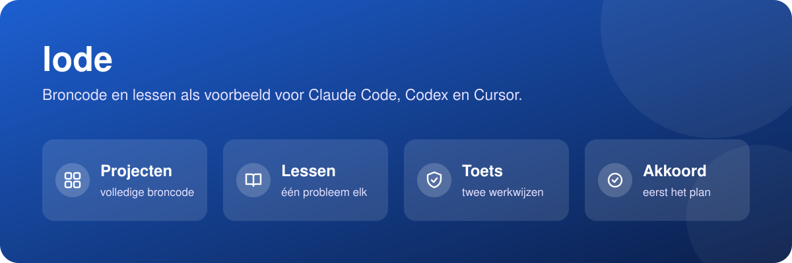

<p align="center"></p>

<p align="center">


</p>

<p align="center"><b>Voorbeelden uit echte code, en een plan dat jij goedkeurt.</b><br>Complete codebases, 111 ontwerpkaarten en een werkwijze voor Claude Code, Codex en Cursor.</p>

<p align="center"><a href="#installeren">Installeren</a> · <a href="#wat-je-typt">Wat je typt</a> · <a href="#zo-zit-het-in-elkaar">Diagram</a> · <a href="#de-codebases">Codebases</a> · <a href="#hoe-je-ziet-dat-het-klopt">Bewijs</a> · <a href="#waar-het-ophoudt">Grenzen</a></p>

## Het probleem

Een taalmodel leerde van alle code die het kon vinden, goede en slechte door elkaar. Het uitgangspunt van lode: een beter voorbeeld op het juiste moment stuurt meer dan nog een instructie.

| Faalwijze | Wat er gebeurt | Wat lode doet |
|---|---|---|
| **De standaardpagina** | Het model kiest wat het vaakst voorkwam: dezelfde kaarten, dezelfde iconen, geen leeg- of foutscherm | Een echt scherm als bron, met toestanden, toetsen en randgevallen |
| **De moeilijke helft ontbreekt** | Rechten, goedkeuring, herstel na een crash en dubbele uitvoering staan zelden in voorbeelden | Codebases die het in productie oplossen, en een kaart per idee |
| **Geen maatstaf** | Het model ziet niet of een voorbeeld goed is | Elke kaart heeft een bron op de regel, een grens en een toetsvraag |
| **Te snel bouwen** | De eerste aanpak wordt de enige aanpak | Elk plan gaat langs `airesearch` of `council`, en jij keurt het goed |

## Wat je krijgt

| Laag | Wat het is | Wanneer |
|---|---|---|
| **29 codebases** | 101.620 bestanden, gelijk aan de maker, vast op één commit | Een app, scherm of architectuur overnemen |
| **`CODEBASES.md`** | Per map: waar je begint, wat bij elkaar hoort, wat je laat liggen | Snel het goede bestand vinden |
| **111 kaarten** | Eén ontwerpidee: probleem, oplossing, wanneer niet, toetsvraag | Een ontwerp maken of keuren |
| **6 skills** | `/lode` en vijf skills die het ondersteunen | Plannen, toetsen, ophalen |
| **`AGENTS.md`** | De route per taak, met een budget van zes kaarten | Alleen laden wat nodig is |


## Installeren

```bash
git clone --depth 1 https://github.com/robinbril/lode.git
```

```bash
python3 lode/install.py
```

Het script koppelt de skills aan Claude Code, Codex en Cursor. Een skill die je al hebt, blijft staan. Het installeert niets uit de codebases en draait ze niet.

## Wat je typt

| Je wilt | Je typt | Je krijgt |
|---|---|---|
| Iets bouwen in een bestaand product | `/lode Voeg [functie] toe aan [project], voor [gebruiker] op [scherm]` | Wat er al is, de beste bron, een getoetst plan, dan een dunne plak met test |
| Een nieuw project | `/lode Nieuw project: [naam] voor [gebruiker] met [taak]` | Twee opzetten naast elkaar, een keuze, en per dag één werkend resultaat |
| Een scherm overnemen | `/lode Neem de composer van grokbot over in [project], in Vue 3 en onze tokens` | Eerst de toestanden en toetsen, dan de bouw, op 1440 en 390 px |
| Een keuze maken | `/lode We twijfelen tussen [A] en [B] voor [doel]` | Per optie het beste voorbeeld, een advies, en wat de keuze zou omdraaien |

Is de aanpak duidelijk, dan schrijft `/lode` het plan uit en vraagt akkoord. Staat de aanpak open, dan krijg je een aanbeveling met hooguit twee alternatieven. Tot jouw akkoord verandert er niets. Meer opdrachten om te plakken staan in [`prompts.md`](skills/lode/references/prompts.md).

## Zo zit het in elkaar

<p align="center">
<picture>
<source media="(prefers-color-scheme: dark)" srcset="docs/lode-dark.png">

</picture>
</p>

## De codebases

### AI-architectuur

| Codebase | Waarvoor je hem opent |
|---|---|
| [`deepseek-harness`](ai-architecture/deepseek-harness) | Harness waarin alles een plugin is, met een sessielog als gebeurtenissen |
| [`opencode`](ai-architecture/opencode) | Agentlus in TypeScript: providerlaag, sessies, tool-plugins |
| [`codex`](ai-architecture/codex) | Codeer-agent in Rust: exec-policy, sandbox van het besturingssysteem, patchformaat |
| [`openbot`](ai-architecture/openbot) | Werkplek voor bots: goedkeuring, beleid, audit, eigen computer per bot |
| [`qm`](ai-architecture/qm) | Teamagent voor Slack en web, met een sandbox per scope |
| [`pydantic-ai`](ai-architecture/pydantic-ai) | Getypeerde agent in Python: toolsets, duurzame uitvoering, evals |
| [`onyx`](ai-architecture/onyx) | Bedrijfskennis met rechten: connectors, indexering, zoeken |
| [`claude-agent-sdk`](ai-architecture/claude-agent-sdk) | Claude Code aansturen vanuit Python: hooks, permissies, sessieopslag |
| [`openai-agents`](ai-architecture/openai-agents) | Handoffs, guardrails en goedkeuring die je kunt hervatten |
| [`open-multi-agent`](ai-architecture/open-multi-agent) | Team van agents: taakgrafiek, journaal, duurzame goedkeuring |

### Frontend

| Codebase | Waarvoor je hem opent |
|---|---|
| [`grokbot`](frontend/grokbot) | Composer, gesprekken en werkplek zonder framework |
| [`openmausbot`](frontend/openmausbot) | Chat-app met een team van bots: goedkeuringskaart en computerpaneel |
| [`assistant-ui`](frontend/assistant-ui) | Chat-primitieven voor React |
| [`ai-elements`](frontend/ai-elements) | Onderdelen voor modeluitvoer |
| [`chatbot`](frontend/chatbot) | Complete chat-app op Next.js |
| [`shadcn-ui`](frontend/shadcn-ui) | Componenten die je zelf bezit |
| [`radix-primitives`](frontend/radix-primitives) | Menu, dialoog, popover en tooltip met toetsenbord en focus |
| [`sonner`](frontend/sonner) | Meldingen |
| [`cmdk`](frontend/cmdk) | Commandomenu |
| [`tanstack-virtual`](frontend/tanstack-virtual) | Lange lijsten zonder haperen |
| [`json-render`](frontend/json-render) | Interface uit modeluitvoer, binnen een vast schema |
| [`aicss`](frontend/aicss) | React-componenten voor gesprekken met een agent |
| [`circle`](frontend/circle) | Takenbord en issue-schermen |

### Backend

| Codebase | Waarvoor je hem opent |
|---|---|
| [`fastapi-template`](backend/fastapi-template) | SaaS-basis met FastAPI, Postgres en React |
| [`polar`](backend/polar) | Betalingen en abonnementen in productie |
| [`hatchet`](backend/hatchet) | Wachtrij en achtergrondwerk, met fair scheduling per tenant |
| [`dbos`](backend/dbos) | Duurzame workflows op Postgres |
| [`svix`](backend/svix) | Webhooks: ondertekenen, herhalen, uitleveren |
| [`openfga`](backend/openfga) | Rechten op relaties |

De precieze bestanden staan in [`ai-architecture/CODEBASES.md`](ai-architecture/CODEBASES.md), [`frontend/CODEBASES.md`](frontend/CODEBASES.md) en [`backend/CODEBASES.md`](backend/CODEBASES.md).

## De skills

| Skill | Waarvoor |
|---|---|
| [`lode`](skills/lode/SKILL.md) | Aanpassen, nieuw bouwen of overnemen, met een plan dat jij goedkeurt |
| [`airesearch`](ai-architecture/skills/airesearch/SKILL.md) | Een AI-ontwerp scoren op tien assen, met bewijs uit de code |
| [`council`](ai-architecture/skills/council/SKILL.md) | Een lastige keuze langs onafhankelijke stemmen, blinde beoordeling en een synthese |
| [`ui-ophalen`](frontend/skills/ui-ophalen/SKILL.md) | Een interface ophalen die hier nog niet staat |
| [`rea`](frontend/skills/rea/SKILL.md) | Een site, app of pakket ontleden, met een bewijsketen |
| [`pick-ui-library`](frontend/skills/pick-ui-library/SKILL.md) | De juiste UI-library kiezen |

## Hoe je ziet dat het klopt

```bash
python3 check.py
```

```bash
python3 copy.py check
```

- `check.py` zoekt het kernwoord van elke bronregel op in de vaste commit: **280 van 280 kloppen**. 29 webbronnen controleert het script niet.
- `copy.py check` vergelijkt elke codebase met de commit van de maker: **101.620 bestanden gelijk**.
- Een plan met `/lode` noemt zijn bron met een pad, en wat de toets aan het ontwerp veranderde.

## Waar het ophoudt

- **Beter resultaat is niet gemeten.** In één blinde proef scoorde een plan met `/lode` 59,5 en een plan zonder 64,5. De skill is daarna ingekort en niet opnieuw getest. Meet het op je eigen taak, met en zonder.
- **Het kost tijd.** De toets en het akkoord komen vóór de eerste regel code. Voor één bestand dat je met één commit terugdraait, sla je ze over.
- **Claude Code zelf staat er niet in.** Wel de officiële SDK. De motor is gesloten.
- **Het zijn kopieën om te lezen.** Draai of installeer ze niet vanuit deze repo. Afhankelijkheden zijn bevroren en krijgen geen beveiligingsupdates.
- **Niet alles is meegenomen.** Buiten bleven `ee`, `enterprise`, `.github`, beeld en video boven 100 kB en bestanden boven 1 MB. `grokbot` mist de lettertypes, iconen en bewegingsdata uit Grok en start niet zonder aanpassing.
- **Stuurbestanden heten anders.** `AGENTS.md` wordt `AGENTS.md.bron`, zodat de regels van een ander niet voor jou gelden.

## Bijwerken

Zet een nieuwe commit in `codebases.json` en haal de codebase opnieuw op:

```bash
python3 copy.py take sonner
```

## Herkomst en licenties

De code is van de makers en houdt hun licentie. Neem de licentietekst mee als je code overneemt. Gelezen bronnen zonder kopie staan in [`sources.json`](sources.json).

<details>
<summary>Alle 29 codebases met bron, commit en licentie</summary>

| Codebase | Bron | Commit | Licentie |
|---|---|---|---|
| `deepseek-harness` | [deepseek-ai/deepseek-harness](https://github.com/deepseek-ai/deepseek-harness) | [`4b399c39a`](https://github.com/deepseek-ai/deepseek-harness/tree/4b399c39a6d1479cd84ca591b4d7c88e24d38a96) | MIT |
| `opencode` | [anomalyco/opencode](https://github.com/anomalyco/opencode) | [`0089ba9e3`](https://github.com/anomalyco/opencode/tree/0089ba9e39a9ff7701b83fa87d62964612b61a66) | MIT |
| `codex` | [openai/codex](https://github.com/openai/codex) | [`02390c8d8`](https://github.com/openai/codex/tree/02390c8d8e39a9b72d12e04e83987d5eb6801310) | Apache-2.0 |
| `openbot` | [robinbril/OpenBot](https://github.com/robinbril/OpenBot) | [`f8af37ab7`](https://github.com/robinbril/OpenBot/tree/f8af37ab73e96784f174a11104505a965e722cab) | MIT |
| `qm` | [yc-software/qm](https://github.com/yc-software/qm) | [`9dd19899b`](https://github.com/yc-software/qm/tree/9dd19899b0414bad494eedbd87696eaab23a9907) | MIT |
| `pydantic-ai` | [pydantic/pydantic-ai](https://github.com/pydantic/pydantic-ai) | [`d32d5c648`](https://github.com/pydantic/pydantic-ai/tree/d32d5c648bec67496dfcfb93803d257e6996d9c8) | MIT |
| `onyx` | [onyx-dot-app/onyx](https://github.com/onyx-dot-app/onyx) | [`2582a29ef`](https://github.com/onyx-dot-app/onyx/tree/2582a29ef5a52ffff360777b02c47ebff48478ff) | MIT, zonder `ee` |
| `claude-agent-sdk` | [anthropics/claude-agent-sdk-python](https://github.com/anthropics/claude-agent-sdk-python) | [`318436039`](https://github.com/anthropics/claude-agent-sdk-python/tree/3184360393a92ca8a6ec7bbbdee571afd1ce1c56) | MIT |
| `openai-agents` | [openai/openai-agents-python](https://github.com/openai/openai-agents-python) | [`6c4e4a29c`](https://github.com/openai/openai-agents-python/tree/6c4e4a29cd08eef454db6980d74da6afc8939d24) | MIT |
| `open-multi-agent` | [open-multi-agent/open-multi-agent](https://github.com/open-multi-agent/open-multi-agent) | [`e1059babc`](https://github.com/open-multi-agent/open-multi-agent/tree/e1059babc907663444a2a475e2548c61b85cea9b) | MIT |
| `grokbot` | [robinbril/grokbot-reconstruction](https://github.com/robinbril/grokbot-reconstruction) | [`b2e1c8629`](https://github.com/robinbril/grokbot-reconstruction/tree/b2e1c8629027d05ff61f5c84ab42a1c6c2c9417b) | geen licentiebestand |
| `openmausbot` | [milind-soni/OpenMausBot](https://github.com/milind-soni/OpenMausBot) | [`77f41d352`](https://github.com/milind-soni/OpenMausBot/tree/77f41d3522217a484b4abdffa9d5f6ba651f84bd) | Apache-2.0, zonder `enterprise` |
| `assistant-ui` | [assistant-ui/assistant-ui](https://github.com/assistant-ui/assistant-ui) | [`822754470`](https://github.com/assistant-ui/assistant-ui/tree/8227544705c6045e70545711ee38d09040e1a282) | MIT |
| `ai-elements` | [vercel/ai-elements](https://github.com/vercel/ai-elements) | [`ca8be600b`](https://github.com/vercel/ai-elements/tree/ca8be600bfd01b3131f9bf6134b51602a71f4374) | Apache-2.0 |
| `chatbot` | [vercel/chatbot](https://github.com/vercel/chatbot) | [`a8989b522`](https://github.com/vercel/chatbot/tree/a8989b522fa3672a2ae52f053105e40993b36ca1) | Apache-2.0 |
| `shadcn-ui` | [shadcn-ui/ui](https://github.com/shadcn-ui/ui) | [`055aa6b78`](https://github.com/shadcn-ui/ui/tree/055aa6b7837b1808456a24beb4c97a677864aa82) | MIT |
| `radix-primitives` | [radix-ui/primitives](https://github.com/radix-ui/primitives) | [`eb3a2b709`](https://github.com/radix-ui/primitives/tree/eb3a2b7091293e27df8f9ba906632d8daa3d81a3) | MIT |
| `sonner` | [emilkowalski/sonner](https://github.com/emilkowalski/sonner) | [`8e4662b39`](https://github.com/emilkowalski/sonner/tree/8e4662b39255120b62138312058f5d77c0139a5e) | MIT |
| `cmdk` | [dip/cmdk](https://github.com/dip/cmdk) | [`dd2250ed6`](https://github.com/dip/cmdk/tree/dd2250ed608443e8f32bafc5fa2d1d07a3746aa3) | MIT |
| `tanstack-virtual` | [TanStack/virtual](https://github.com/TanStack/virtual) | [`ec46ffc40`](https://github.com/TanStack/virtual/tree/ec46ffc40078de88e18bd8a5e2ff41689d5bfcaa) | MIT |
| `json-render` | [vercel-labs/json-render](https://github.com/vercel-labs/json-render) | [`c92690785`](https://github.com/vercel-labs/json-render/tree/c926907855d95dde328264350ac5464b60be201d) | Apache-2.0 |
| `aicss` | [kvnkld/aicss](https://github.com/kvnkld/aicss) | [`7f9dc408e`](https://github.com/kvnkld/aicss/tree/7f9dc408ec1137db52e0b1753e72b49b2363d947) | MIT |
| `circle` | [ln-dev7/circle](https://github.com/ln-dev7/circle) | [`b0ba7ddcc`](https://github.com/ln-dev7/circle/tree/b0ba7ddcc3d0f4c16092236ca6a01b56c0614810) | MIT |
| `fastapi-template` | [fastapi/full-stack-fastapi-template](https://github.com/fastapi/full-stack-fastapi-template) | [`77e550a73`](https://github.com/fastapi/full-stack-fastapi-template/tree/77e550a73bb49dd2967622c5ed11bf7a49603c93) | MIT |
| `polar` | [polarsource/polar](https://github.com/polarsource/polar) | [`b0be821b5`](https://github.com/polarsource/polar/tree/b0be821b5c47ae86ffd50556b44829051c9dd329) | Apache-2.0 |
| `hatchet` | [hatchet-dev/hatchet](https://github.com/hatchet-dev/hatchet) | [`2a0b38636`](https://github.com/hatchet-dev/hatchet/tree/2a0b386361abbb0164b454b5cf24e668a671d101) | MIT |
| `dbos` | [dbos-inc/dbos-transact-py](https://github.com/dbos-inc/dbos-transact-py) | [`28192bd87`](https://github.com/dbos-inc/dbos-transact-py/tree/28192bd87ee81891546803fb583ea6a22c08d1ce) | MIT |
| `svix` | [svix/svix-webhooks](https://github.com/svix/svix-webhooks) | [`c35d595bc`](https://github.com/svix/svix-webhooks/tree/c35d595bcb3de3ccecc4d2b49e98669c66c05a72) | MIT |
| `openfga` | [openfga/openfga](https://github.com/openfga/openfga) | [`d67ba7b1d`](https://github.com/openfga/openfga/tree/d67ba7b1d2eaf945cffab3a9129ca1a4c7ad5251) | Apache-2.0 |

</details>
